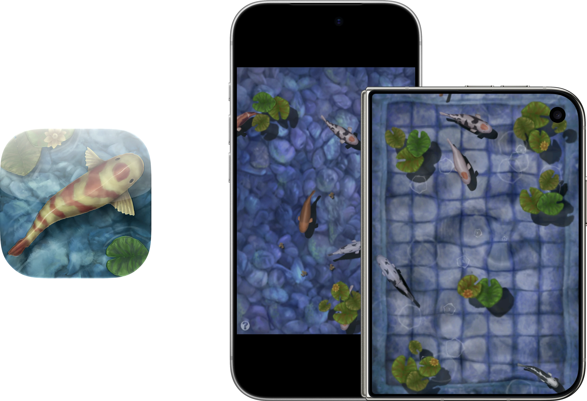

  

# Respring – Koi Pond
One of the iconic classic iPhone apps, never quite replicated in any future attempt. So, with the help of Codex (GPT-6 Astra and GPT 6.1 Sol), you can once again relax with your own koi pond on any modern iOS device!

### How does it work?
This build runs the original Koi Pond game through ahead-of-time ARM/Thumb-to-ARM64 translation. A modified touchHLE runtime supplies the legacy iOS APIs, with native iOS presentation and audio handling. No JIT required!

### Enhancements
- Full Resolution: render the pond at full resolution, while retaining the original 3.5-inch iPhone aspect ratio.
- Full Frame Rate: the original app was stuck at 24 FPS. Now, you can enjoy up to 120 FPS!
- Fill Screen: if you are using iPhone Duo, you'll notice that the aspect ratios of the displays are very close to that of a 3.5-inch iPhone. This option fills the screen so you don't have slight black bars on the side.
- App Icon: I have "remastered" the app icon with Icon Composer with full support for Default, Dark, Clear, and Tinted modes.

### Notes
- The app enhancements can be enabled or disabled in Settings → Apps → Koi Pond.
- The app relies on using the 3.5-inch iPhone aspect ratio. This new build doesn't attempt to change or "fix" that.
- It's not perfect! There may still be crashes. If you experience a crash or some other issue, please open an Issue on this repository.

As stated before, this project was achieved through the usage of generative AI. Outside of this README and Releases release notes, most things were written by an AI agent.

## How to Install
Download **Koi-Pond.ipa** from [Releases](https://github.com/DylanMcD8/respring-koi-pond/releases). It is an **unsigned ARM64 device IPA**: use your own signing/sideloading workflow to sign it for your device. [Sideloadly](https://sideloadly.io) is one option.

Alternatively, build and run **KoiPond.xcodeproj** with your own Apple development team.

The deployment target is iOS/iPadOS 15.0. Earlier testing covered iPhone Air, iPhone 18 Pro, iPad Pro 13-inch (M4), and the iPhone Duo simulator. Those tests do not establish compatibility with every older OS version. The simulator build targets Apple silicon Macs.

## Build from Source
*Written by AI agent*

Use an Apple silicon Mac with full Xcode, Python 3, Rust 1.99.0, and CMake. Xcode 27.1 and CMake 4.3.5 were used for the completed restoration builds. Rust dependencies and the modified SDL2 sources are included.

1. Install the toolchain and ARM64 targets described in [BUILDING.md](BUILDING.md).
2. Open `KoiPond.xcodeproj`, select the **KoiPond** scheme and your destination.
3. For a physical device, select your own development team and an available bundle identifier.
4. Build and run. The first build compiles the runtime and generated game translations and can take a while.

See [BUILDING.md](BUILDING.md) for command-line builds, packaging, tests, and source layout.

## Credits and Licensing
Koi Pond and its original game content belong to their respective rights holders. The original executable, artwork, audio, and game-derived material are not relicensed by this project's open-source notices. This is an unofficial preservation project with no claim of rights-holder affiliation or endorsement.

The compatibility runtime derives from [touchHLE](https://github.com/touchHLE/touchHLE), with MPL-2.0 notices preserved. SDL2, Rust dependencies, fonts, and bundled runtime libraries retain their own licenses.

See [LICENSE.md](LICENSE.md), [THIRD_PARTY_NOTICES.md](THIRD_PARTY_NOTICES.md), and the notices beside the sources. Matching project and runtime source downloads accompany the IPA.
